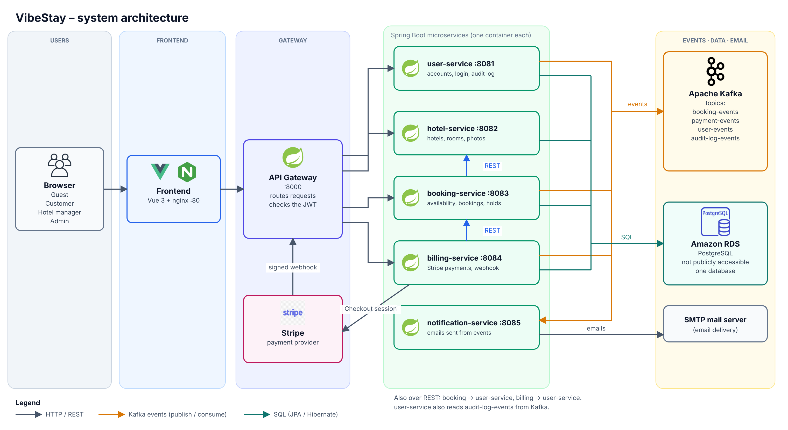
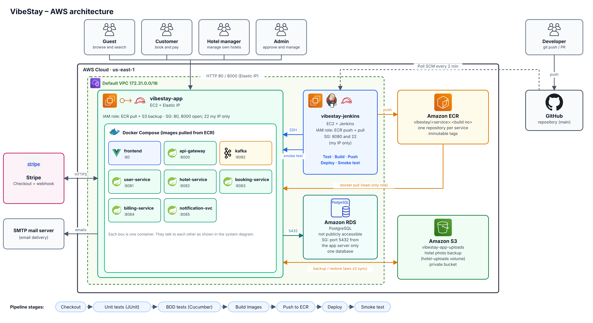
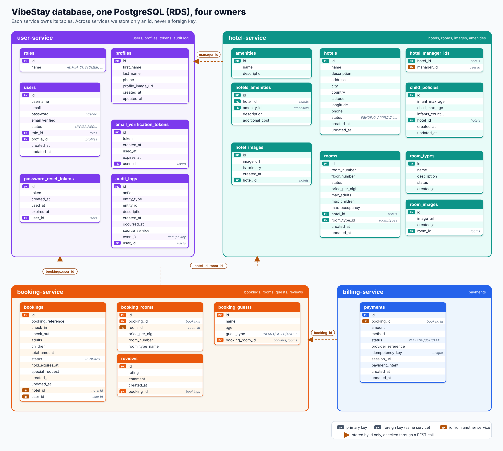

# VibeStay

VibeStay is a hotel booking platform. Guests search for hotels, check which rooms are free on their dates, book one or more rooms, pay online with Stripe and review their stay. Hotel managers run their own hotels, and admins approve hotels and look after users.

I first built it as one Spring Boot application. For this project I split it into microservices, put Kafka between them, packaged everything in Docker and deployed it to AWS with a Jenkins pipeline. This README tells the story of how it works and how I built it.

## Contents

[What it does](#what-it-does) · [Architecture](#architecture) · [Services](#services) · [Kafka](#kafka-events) · [Docker](#docker) · [CI/CD](#cicd-with-jenkins) · [AWS](#aws-deployment) · [Getting started](#getting-started) · [Environment variables](#environment-variables) · [Testing](#testing) · [API documentation](#api-documentation) · [Challenges](#main-challenges) · [Unsolved problems](#unsolved-problems) · [Future improvements](#future-improvements) · [Resources](#resources)

## What it does

**Guests**
- Register, verify their email, log in, reset or change a password
- Search hotels by city and dates, filter by price and room type, and see them on a map
- Book several rooms in one booking, with the name and age of every guest
- Pay with Stripe Checkout (the rooms are held for 15 minutes while they pay)
- Cancel a booking, see their own bookings, and review a completed stay

**Hotel managers**
- Create hotels (an admin approves them) and manage only their own hotels
- Manage rooms, photos, amenities and the child policy
- See new bookings live, without refreshing the page

**Admins**
- Approve, reject, activate or deactivate hotels, assign managers, manage users and room types

**Behind the scenes**
- JWT login checked at the gateway, role based access, password hashing, validation, rate limits and one error format
- Real time notifications with WebSocket and STOMP, and emails sent from Kafka events
- Stripe payments with idempotency keys and a signed webhook
- A job that cancels unpaid bookings when their 15 minute hold runs out
- Row locks so two people cannot book the same room, or pay twice, at the same moment

## Architecture

The browser (guest, customer, hotel manager or admin) opens the Vue front end, which nginx serves. Every API call goes to the **API gateway**, which checks the JWT and sends the request to the right Spring Boot service. The services talk to each other in two ways: **REST** when they need an answer right now, and **Kafka** when they only need to tell others that something happened.



**Before and after.** The first version was one application with one codebase and one deploy. Now each part (users, hotels, bookings, payments, notifications) is its own service with its own image, so I can change, test and deploy one without touching the others.

| | Monolith (before) | Microservices (now) |
|---|---|---|
| Deploy | One jar | Seven containers, each built and pushed on its own |
| Talking to each other | Method calls | REST and Kafka |
| Failure | One bug can stop everything | Notifications can be down and bookings still work |
| Data | One schema, foreign keys everywhere | Each service owns its tables and keeps only ids of the others |

### AWS

Everything runs on AWS in `us-east-1`. Jenkins builds the Docker images, pushes them to ECR and deploys them to the app server with Docker Compose. The database is on RDS and only the app server can reach it.



### Database

There is one PostgreSQL database on RDS, but each service only reads and writes its own tables. A table never has a foreign key to another service's table. It keeps just the id (for example `bookings.user_id`) and asks the other service over REST when it needs details.



Two small things to know: the `roles` table exists in both user-service and hotel-service (they share one database), and managers of a hotel are stored as ids in `hotel_manager_ids`.

## Services

| Service | Port | What it is responsible for | Data it owns | Talks to |
|---|---|---|---|---|
| api-gateway | 8000 | One entry point, JWT check, routing, CORS | none | all services (REST) |
| user-service | 8081 | Register, login, email verification, password reset, profiles, roles, admin user management, audit log | users, profiles, roles, tokens, audit_logs | Kafka (publishes `user-events`, reads `audit-log-events`) |
| hotel-service | 8082 | Hotels, rooms, room types, amenities, photos, child policy, hotel approval | hotels, rooms, room_types, amenities, images, child_policies | Kafka (publishes `audit-log-events`) |
| booking-service | 8083 | Availability, bookings, guests, cancellation, hold expiry job, reviews, WebSocket events | bookings, booking_rooms, booking_guests, reviews | REST to hotel-service and user-service, Kafka (publishes `booking-events`, `audit-log-events`) |
| billing-service | 8084 | Stripe Checkout, webhook, idempotent payments | payments | REST to booking-service and user-service, Kafka (publishes `payment-events`) |
| notification-service | 8085 | Sends emails from events | none | Kafka (reads `booking-events`, `payment-events`, `user-events`), SMTP |
| frontend | 80 | Vue app served by nginx | none | api-gateway |

**How the gateway routes.** `/auth/users/**` and `/api/admin/**` go to user-service, `/api/hotels/**`, `/api/amenities/**` and `/api/rooms-types/**` go to hotel-service, `/api/bookings/*/payment` and `/webhook` go to billing-service, and everything else under `/api/**` goes to booking-service.

**REST or Kafka?** If the caller needs the answer to continue (booking asks hotel-service for room prices, billing asks booking-service for the amount), it uses REST. If the caller is just announcing a fact (a booking was confirmed), it publishes a Kafka event and does not wait.

## Kafka events

Kafka runs in a container (KRaft mode, no ZooKeeper). Topics:

| Topic | Producer | Consumer | Example |
|---|---|---|---|
| `booking-events` | booking-service | notification-service | booking confirmed or cancelled, so send the email |
| `payment-events` | billing-service | notification-service | payment succeeded |
| `user-events` | user-service | notification-service | verification and password reset emails |
| `audit-log-events` | booking-service, hotel-service | user-service | who did what, saved to `audit_logs` |

Example event on `booking-events` (simplified):

```json
{ "eventId": "b7c1…", "type": "BOOKING_CONFIRMED", "bookingReference": "VB1A2B", "status": "CONFIRMED", "userId": 24, "hotelId": 1, "hotelName": "VibeStay Manama Grand" }
```

**Reliability.** The audit consumer in user-service retries a failed message and then moves it to a dead letter topic (`DefaultErrorHandler` with `DeadLetterPublishingRecoverer`). It also stores each `eventId`, so a message delivered twice is saved once. Each consumer uses its own consumer group.

**Limits I know about.** Kafka is a single broker (no replication), and the notification consumers do not yet have their own retry and dead letter topic, so a failed email is logged and not retried.

## Docker

Each service has its own `Dockerfile` (a multi stage build: Maven builds the jar, then a small Java 17 image runs it). `docker-compose.yaml` starts everything: Kafka, the six services and the front end. Every container has a health check, and services wait for the ones they depend on.

```bash
docker compose up -d --build     # build and start everything
docker compose ps                # check all containers are healthy
docker compose logs -f booking-service
docker compose down
```

Images are tagged by `REGISTRY` and `TAG` in `.env` (`${REGISTRY}/booking-service:${TAG}`). On the server the tag is a version made from the Jenkins build number (`1.0.<build>`, for example `1.0.7`), and the containers run with `SPRING_PROFILES_ACTIVE=prod`, so going back to an older version means setting `TAG` to an older build and running `docker compose up -d`.

## CI/CD with Jenkins

A Jenkins server (its own EC2 instance) checks GitHub every 2 minutes (Poll SCM). When it sees a new commit it runs the pipeline in the `Jenkinsfile`:

| Stage | What happens |
|---|---|
| Checkout | Pull the code from GitHub |
| Unit tests (JUnit) | Run the JUnit tests of booking-service and billing-service (when `RUN_TESTS` is ticked) |
| BDD tests (Cucumber) | Run the Cucumber scenarios for booking and payment (when `RUN_TESTS` is ticked) |
| Build images | Build a Docker image for every service, tagged with the build number |
| Push to ECR | Log in to Amazon ECR and push the images |
| Deploy | SSH to the app server, `docker pull` the new tag, `docker compose up -d` |
| Smoke test | Call the deployed site until it answers (up to 30 tries, 5 seconds apart) |

The test stages are behind the `RUN_TESTS` option (Build with Parameters) so a quick deploy is possible. The test reports show in Jenkins from the JUnit result files.

## AWS deployment

| Service | Why I use it |
|---|---|
| EC2 `vibestay-app` | Runs all containers with Docker Compose, with an Elastic IP so the address does not change |
| EC2 `vibestay-jenkins` | Runs Jenkins |
| ECR | Stores the Docker images, one repository per service |
| RDS (PostgreSQL) | The database, not publicly accessible |
| VPC and security groups | Default VPC. The site is open on port 80, RDS accepts port 5432 only from the app server's security group, SSH and Jenkins (8080) are limited to my IP |
| IAM | Permissions so Jenkins can push to ECR and the app server can pull from it, with no AWS keys in the repository |

**Security notes.** No secrets are in the repository. They live in a `.env` file on the server and in Jenkins credentials. The database is not open to the internet, nginx is the public door (port 80) and forwards API calls to the gateway. The site runs on HTTP for now (see Future improvements).

**Deploying by hand** (the pipeline does this for you): copy `docker-compose.yaml` and `.env` to the server, log in to ECR, then run

```bash
docker compose pull
docker compose up -d
docker compose ps
```

## Getting started

You can run VibeStay locally with Docker, or run one service at a time from your IDE.

**1. Clone**

```bash
git clone https://github.com/Batool-Isa/hotel-booking-system.git
cd hotel-booking-system
```

**2. Create the `.env` file** next to `docker-compose.yaml` (see the table below). No secrets are stored in the repository.

**3. Start everything**

```bash
docker compose up -d --build
```

Open `http://localhost` for the app, or `http://localhost:8000/swagger-ui/index.html` for Swagger.

**Payments locally.** Stripe cannot reach `localhost`, so forward its webhooks with the [Stripe CLI](https://docs.stripe.com/stripe-cli). Keep this running in a second terminal:

```bash
stripe listen --api-key <your sk_test_... key> --events checkout.session.completed --forward-to localhost:8000/webhook
```

It prints `Your webhook signing secret is whsec_...`. Put that in `STRIPE_WEBHOOK_SECRET` and restart billing-service. Pay with the test card `4242 4242 4242 4242`, any future date and any CVC. After paying, the terminal shows `checkout.session.completed [200]` and the booking becomes `CONFIRMED`. A `[400]` means the webhook secret does not match.

**Demo data.** The first time the app starts on an empty database, it adds demo data (11 hotels across the Gulf, about 490 bookings, a fixed seed so every fresh database is the same). These passwords are fake and for development only.

| Role | Login |
|---|---|
| Admin | `admin@vibestay.com` / `Admin123!` |
| Managers | `manager1` to `manager6@vibestay.com` / `Manager123!` |
| Customers | `customer1` to `customer24@vibestay.com` / `Customer123!` |

## Environment variables

Names only, copy `.env.example` and fill in your own values.

| Variable | Purpose |
|---|---|
| `DB_URL`, `DB_USERNAME`, `DB_PASSWORD` | PostgreSQL connection |
| `JWT_SECRET` | Base64 key for signing tokens, at least 32 bytes (`openssl rand -base64 48`) |
| `INTERNAL_API_KEY` | Shared key for calls between services |
| `FRONTEND_URL`, `PUBLIC_API_URL` | Used in emails and Stripe redirect links |
| `STRIPE_SECRET_KEY`, `STRIPE_WEBHOOK_SECRET` | Stripe test keys (`sk_test_...`, `whsec_...`) |
| `MAIL_USERNAME`, `MAIL_PASSWORD` | SMTP account (a Gmail app password) |
| `REGISTRY`, `TAG` | Which Docker images to run (set by the pipeline on the server) |
| `SPRING_PROFILES_ACTIVE` | `dev` on your machine, `prod` in Docker (Compose sets it). Prod turns off SQL logging and debug logs |

## Monitoring and health

Every service has Spring Boot Actuator with a health endpoint (`/actuator/health`, no details exposed). Logs are written to the containers and to `logs/application.log`, and you read them with `docker compose logs -f <service>`. In production the SQL logging and debug logs are off (`application-prod.properties`).

## Testing

| Kind | Where | What it covers |
|---|---|---|
| JUnit and Mockito | `booking-service`, `billing-service` (`service/*Test`) | Business rules for bookings, payments, reviews |
| Concurrency | `BookingConcurrencyTest`, `PaymentConcurrencyTest`, `ReviewConcurrencyTest` | Many threads at once: one booking wins, one payment is confirmed, one review is saved |
| Cucumber (BDD) | `booking-service` and `billing-service`, `src/test/resources/features` | Booking: reading my own booking, not other people's. Payment: paying my own booking, another user is refused (403), the same idempotency key pays once, a webhook with a wrong signature is rejected, a correctly signed webhook marks the payment as succeeded |

Run them from the project root:

```bash
./mvnw test -pl services/booking-service,services/billing-service
```

Tests use an in memory H2 database and fake Stripe keys, so they need no PostgreSQL and no secrets. In Jenkins, tick `RUN_TESTS` in Build with Parameters to run the JUnit and Cucumber stages before the build.

The smoke test at the end of the pipeline is different: it is not a test of the code, it just checks that the deployed site answers after a deploy.

## API documentation

Base URL: `http://localhost:8000`. The full interactive documentation is in Swagger at `http://localhost:8000/swagger-ui/index.html`, where you can log in, authorize with a token and try every endpoint.

"Public" means no token is needed. Everything else needs the header `Authorization: Bearer <token>`. Lists accept `page`, `size` and `sort`, for example `?page=0&size=10&sort=name,asc`.

### Authentication and profile (`/auth/users`)

| Method | Path                              | Access | What it does |
|---|-----------------------------------|---|---|
| POST | `/auth/users/register`            | Public | Register (profile photo is optional, sent as multipart form data) |
| GET | `/auth/users/verify-email?token=` | Public | Verify email |
| POST | `/auth/users/login`               | Public | Log in, returns the JWT |
| POST | `/auth/users/forgot-password`     | Public | Send a password reset link |
| POST | `/auth/users/reset-password`      | Public | Set a new password with the link token |
| POST | `/auth/users/change-password`     | Logged in | Change my password |
| GET, PUT | `/auth/users/profile`             | Logged in | View or update my profile |
| PUT | `/auth/users/profile/image`       | Logged in | Change my profile photo |

### Hotels (`/api/hotels`)

| Method | Path | Access | What it does |
|---|---|---|---|
| GET | `/api/hotels` | Public | Search live hotels (`search`, `name`, `city`, `country`) |
| GET | `/api/hotels/{id}` | Public | Hotel details with images, amenities and policy |
| POST | `/api/hotels` | Admin, Manager | Create a hotel (a manager's hotel waits for approval) |
| PUT | `/api/hotels/{id}` | Admin, Manager | Update a hotel (managers: only their own) |
| GET | `/api/hotels/my-hotels` | Manager | Hotels I manage |
| GET | `/api/hotels/pending` | Admin | Hotels waiting for approval |
| PATCH | `/api/hotels/{id}/status` | Admin | Approve, reject, activate or deactivate |
| POST | `/api/hotels/{hotelId}/managers/{managerId}` | Admin | Assign a manager to a hotel |
| GET, POST, DELETE | `/api/hotels/{hotelId}/images[/{imageId}]` | Public to read, Admin and Manager to change | List, upload and delete hotel photos |
| GET | `/api/hotels/{hotelId}/reviews` | Public | Reviews of a hotel and its average rating |
| GET | `/api/hotels/{hotelId}/child-policy` | Public | View the child policy |
| POST, PUT | `/api/hotels/{hotelId}/child-policy` | Admin, Manager | Create or update the child policy |

### Rooms and room types

| Method | Path | Access | What it does |
|---|---|---|---|
| POST | `/api/hotels/{hotelId}/rooms` | Admin, Manager | Add a room |
| POST | `/api/hotels/{hotelId}/rooms/bulk` | Admin, Manager | Add up to 100 rooms at once (all or nothing) |
| GET | `/api/hotels/{hotelId}/rooms` | Admin, Manager | List rooms |
| GET, PUT | `/api/hotels/{hotelId}/rooms/{roomId}` | Admin, Manager | View or update one room |
| PATCH | `/api/hotels/{hotelId}/rooms/{roomId}/status` | Admin, Manager | ACTIVE, INACTIVE or UNDER_MAINTENANCE (blocked if the room has upcoming bookings) |
| GET | `/api/hotels/{hotelId}/rooms/{roomId}/images` | Public | Room photos |
| POST, DELETE | `/api/hotels/{hotelId}/rooms/{roomId}/images[/{imageId}]` | Admin, Manager | Upload or delete room photos |
| GET | `/api/rooms-types`, `/api/rooms-types/{id}` | Admin, Manager | View room types |
| POST, PUT, PATCH | `/api/rooms-types[/{id}[/status]]` | Admin | Create, update, activate or deactivate room types |

### Amenities

| Method | Path | Access | What it does |
|---|---|---|---|
| GET | `/api/amenities` | Public | The amenity catalog |
| POST | `/api/amenities` | Admin, Manager | Add an amenity to the catalog |
| PUT, DELETE | `/api/amenities/{id}` | Admin | Rename or delete (not allowed while a hotel uses it) |
| POST | `/api/hotels/{hotelId}/amenities` | Admin, Manager | Add an amenity to a hotel (description, extra cost) |
| PUT, DELETE | `/api/hotels/{hotelId}/amenities/{amenityId}` | Admin, Manager | Change or remove it |

### Availability and bookings

| Method | Path | Access | What it does |
|---|---|---|---|
| POST | `/api/availability/search` | Public | Find hotels and rooms free for the dates and guests |
| POST | `/api/bookings` | Customer | Create a PENDING booking (one or more rooms, guests with ages), held for 15 minutes |
| GET | `/api/bookings/my-bookings` | Customer | My bookings |
| GET | `/api/bookings/managed` | Manager | Bookings across my hotels. Filters: `hotelId`, `status`, `when` (`upcoming`, `current`, `past`), `q` (reference, guest name or email). Returns a page with `content` and `totalElements` |
| GET | `/api/bookings/all` | Admin | Every booking, with the same filters as `/managed`. Returns a page with `content` and `totalElements` |
| GET | `/api/bookings/{bookingId}` | Customer, Manager, Admin | Booking details (own booking, own hotel, or any for admin) |
| PATCH | `/api/bookings/{bookingId}/cancel` | Customer, Manager, Admin | Cancel a booking |
| PATCH | `/api/bookings/{bookingId}/status` | Manager, Admin | Mark a confirmed booking COMPLETED |

### Payments and reviews

| Method | Path | Access | What it does |
|---|---|---|---|
| POST | `/api/bookings/{bookingId}/payment` | Customer (booking owner) | Start a Stripe Checkout session, returns the payment page URL. Needs an `Idempotency-Key` header |
| POST | `/webhook` | Stripe only (signed) | Stripe calls this when a payment completes; the booking becomes CONFIRMED |
| POST | `/api/bookings/{bookingId}/review` | Customer (booking owner) | Rate a COMPLETED booking from 1 to 5, with an optional comment (one review per booking) |

### Admin

| Method | Path | Access | What it does |
|---|---|---|---|
| GET | `/api/admin/users` | Admin | Users with filters `status`, `role`, `search`, paging and sorting |
| GET | `/api/admin/users/{id}` | Admin | One user |
| PATCH | `/api/admin/users/{id}/status` | Admin | Activate or deactivate a user |
| DELETE | `/api/admin/users/{id}` | Admin | Deactivate a user (soft delete, data is kept) |

### Example: make a booking

First find free rooms:

```http
POST /api/availability/search
{ "checkIn": "2026-11-10", "checkOut": "2026-11-13", "adults": 2, "children": 1, "city": "Manama" }
```

Then book them (needs a customer token):

```http
POST /api/bookings
{
  "hotelId": 1,
  "checkIn": "2026-11-10",
  "checkOut": "2026-11-13",
  "specialRequest": "Late check-in please",
  "rooms": [
    { "roomId": 5,
      "guests": [ { "name": "Sara Ahmed", "age": 32 }, { "name": "Omar Ahmed", "age": 6 } ] }
  ]
}
```

The reply contains the booking reference and `holdExpiresAt`. The booking is `PENDING` and the rooms are held for 15 minutes. Then start the payment:

```http
POST /api/bookings/{bookingId}/payment
Idempotency-Key: 6f1c2a9e-3b7d-4a51-9c0e-2d8f4b1a7e55
```

The reply is a Stripe Checkout URL. After the guest pays, Stripe calls `/webhook`, the booking becomes `CONFIRMED`, and the confirmation email and live notification are sent. Sending the same `Idempotency-Key` again returns the same payment page instead of creating a second one. If nobody pays within 15 minutes, a scheduled job cancels the booking and the rooms are free again.

After the stay, the manager marks the booking `COMPLETED` and the guest can review it:

```http
POST /api/bookings/{bookingId}/review
{ "rating": 5, "comment": "Great view and friendly staff" }
```

### Errors

Every error uses the same JSON shape, with an `errors` map for validation problems:

```json
{ "timestamp": "2026-10-08T05:48:09", "status": 409, "error": "ALREADY_EXISTS", "message": "User with email ... already exists!", "path": "/auth/users", "errors": null }
```

| Status | Meaning |
|---|---|
| 400 | Validation failed or a business rule was broken (for example a room that is already booked) |
| 401 | Missing or invalid token |
| 403 | Logged in, but not allowed to do this |
| 404 | Not found |
| 409 | Already exists (for example the same email or room number) |
| 429 | Too many requests from one IP address, wait a minute (login and register: 5 per minute, forgot password: 3 per minute) |

## Real time notifications

VibeStay uses WebSocket with STOMP at `ws://localhost:8000/ws`.

A browser cannot send an `Authorization` header when it opens a WebSocket, so the JWT goes in the STOMP `CONNECT` frame. The server checks the token and that the account is active, and refuses the connection otherwise. Every subscription is checked too, and clients cannot publish.

| Destination | Who can subscribe | What they receive |
|---|---|---|
| `/topic/users/{your email}/bookings` | any logged in user | their own booking events |
| `/topic/hotels/{hotelId}/bookings` | managers of that hotel, and admins | events for that hotel |
| `/topic/admin/bookings` | admins | every booking event |

```json
{ "bookingReference": "VB1A2B", "message": "Booking confirmed successfully", "status": "CONFIRMED", "hotelId": 1, "hotelName": "VibeStay Manama Grand" }
```

Events are sent when a booking is confirmed (after payment), cancelled or completed.

### Using it

**In the app.** Log in and a bell icon appears in the header. When a booking is made or cancelled, a pop-up message shows, the bell collects it in a live list, and the My bookings page refreshes without a page reload. Customers are told about their own bookings, managers about their hotels, and admins about everything.

**Any STOMP client.** Open `ws://localhost:8000/ws`, send a `CONNECT` frame with the header `Authorization: Bearer <token>`, then `SUBSCRIBE` to a destination above. Every STOMP frame ends with a NUL character, which is why a plain text WebSocket tool such as Postman is hard to use here. Subscribing to a destination you are not allowed to use, such as another customer's topic or a hotel you do not manage, returns an `ERROR` frame.

## Emails

The app sends verification, password reset and booking emails. They share one design. The booking email shows the reference, hotel, dates, guests, rooms, nights and total, plus a map of the hotel and a "Get directions" button. The map picture is built on the server from OpenStreetMap tiles, so no API key is needed. If the map cannot be made, the email is still sent without it.

## Main challenges

**Room availability.** Before a booking is created, the app checks for an overlapping booking on the same room. A room is taken when `existing check-in < requested check-out` and `existing check-out > requested check-in`. A new guest can still check in on the day another guest leaves.

**Bookings with many rooms and guests.** One booking can hold several rooms, and each room holds its own guests (`Booking`, `BookingRoom`, `BookingGuest`). Each hotel has a child policy that sets the ages for infants, children and adults.

**Payments and the room hold.** A new booking starts as `PENDING` with `holdExpiresAt` 15 minutes ahead. While the hold is active the rooms count as taken. The booking becomes `CONFIRMED` only when the signed Stripe webhook reports the payment as paid and the hold has not run out. A job runs every minute and cancels unpaid bookings whose hold has expired.

**Paying twice and duplicate webhooks.** Each payment request carries an `Idempotency-Key` (unique in the `payments` table), so a double click returns the same Checkout session. Stripe can send the same webhook more than once, so the booking row is locked and an already confirmed booking is skipped.

**Two people booking the same room.** The rooms being booked are locked with a pessimistic write lock before the overlap check, so only the first request wins. Concurrency tests prove it.

**Splitting the monolith.** Breaking the code into services meant breaking the foreign keys too. A booking can no longer join to the hotel table, so it stores `hotelId` and asks hotel-service over REST. I also had to decide what is REST and what is an event, and make the gateway the single place that checks the token.

**Services starting in the wrong order.** Kafka was not ready when services started, so they crashed and restarted. Health checks and `depends_on` fixed it.

**Stripe webhooks in the cloud.** The webhook needs a public address, so after deploying I pointed Stripe at the server and tested the signature check with a Cucumber scenario.

**Secure WebSocket.** The token is checked when the socket connects, guests get a private queue, and managers can only listen to their own hotels.

**Emails with a map.** Google's static map needs billing, so I build the map picture from OpenStreetMap tiles.

## Unsolved problems

- Refunds are not handled when a paid booking is cancelled.
- The notification consumers have no retry or dead letter topic yet.
- Kafka and the services run on one server, so there is no high availability.
- There is no caching yet, so hotel lookups hit the database each time (planned, see below).
- Logs are only in Docker and files, with no central monitoring.
- The site uses HTTP, not HTTPS.
- Hotel photos live in a Docker volume on the server and are lost if the volume is removed.

## Future improvements

- HTTPS with a domain name and a load balancer
- Refunds through Stripe when a paid booking is cancelled
- Caching hotel data (for example Spring Cache with Caffeine, or Redis later) and monitoring with CloudWatch or Prometheus and Grafana
- Retry and dead letter topics for all Kafka consumers
- Photos stored in S3
- Kubernetes or ECS instead of Docker Compose, and a multi broker Kafka
- Replies from managers on reviews, AI hotel recommendations, a mobile app

## Planning

I plan in Jira and build in small steps. [Jira board](https://batooltaher124.atlassian.net/jira/software/projects/KAN/boards/1)

| Phase | What I did |
|---|---|
| 1 to 9. Project 3 | Scope, design, users and JWT, hotels and rooms, booking, extras, front end, payments and reviews, tests |
| 10. Microservices | Split into six services, gateway, REST clients, Kafka events and audit log |
| 11. Docker | Dockerfiles, Compose, health checks |
| 12. AWS | EC2, ECR, RDS, security groups, Elastic IP |
| 13. CI/CD | Jenkins pipeline with tests, build, push, deploy and smoke test |
| 14. Tests and docs | Cucumber for booking and payment, diagrams, README |

## Resources

| Resource | Used for |
|---|---|
| [Spring Boot: sending email via SMTP](https://www.geeksforgeeks.org/springboot/spring-boot-sending-email-via-smtp/) | Email service |
| [Spring Boot logging](https://www.geeksforgeeks.org/springboot/spring-boot-logging/) | Logging setup |
| [Swagger documentation](https://www.baeldung.com/swagger-operation-vs-apiresponse) | API docs annotations |
| [Stripe API integration (video)](https://www.youtube.com/watch?v=BczS-wbxgp4) | Checkout session and webhook |
| [Stripe CLI](https://docs.stripe.com/stripe-cli) | Testing webhooks locally |
| [Thread pooling in Spring](https://dev.to/realnamehidden1_61/how-does-spring-manage-thread-pools-for-web-requests-mid) | Understanding concurrency |
| [Cucumber with Spring](https://cucumber.io/docs/cucumber/) | BDD tests |
| [AWS documentation](https://docs.aws.amazon.com/) | EC2, ECR, RDS, security groups |
| [Jenkins documentation](https://www.jenkins.io/doc/) | Declarative pipeline |
